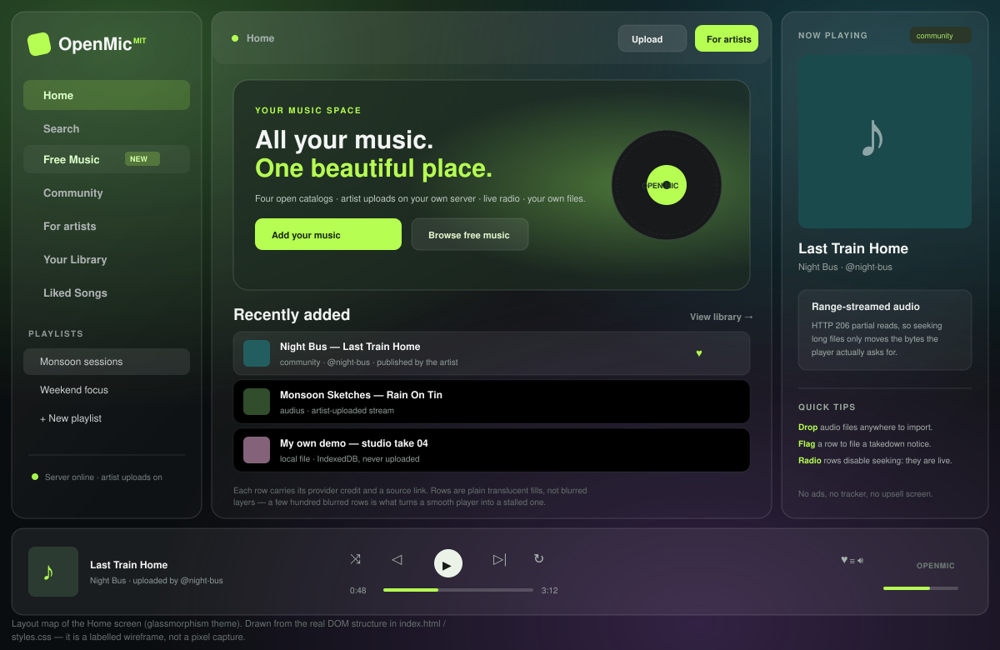
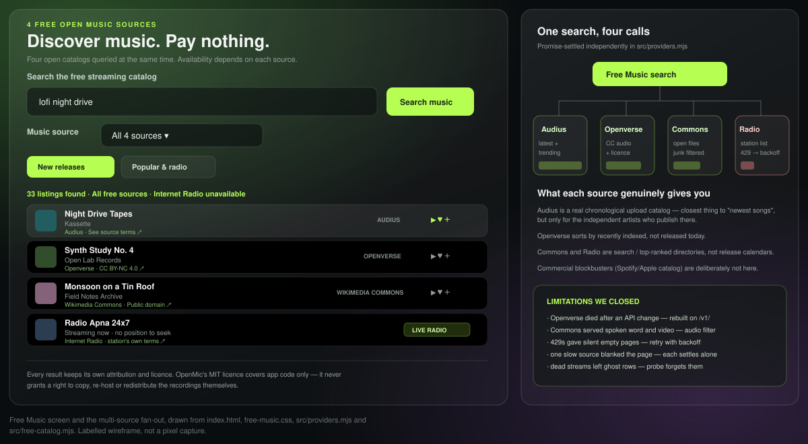
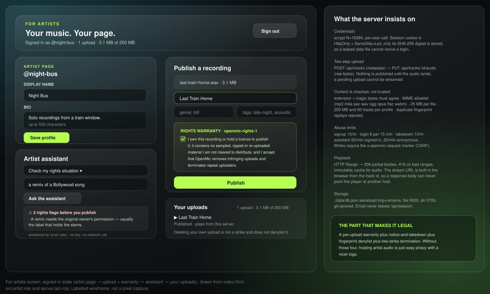
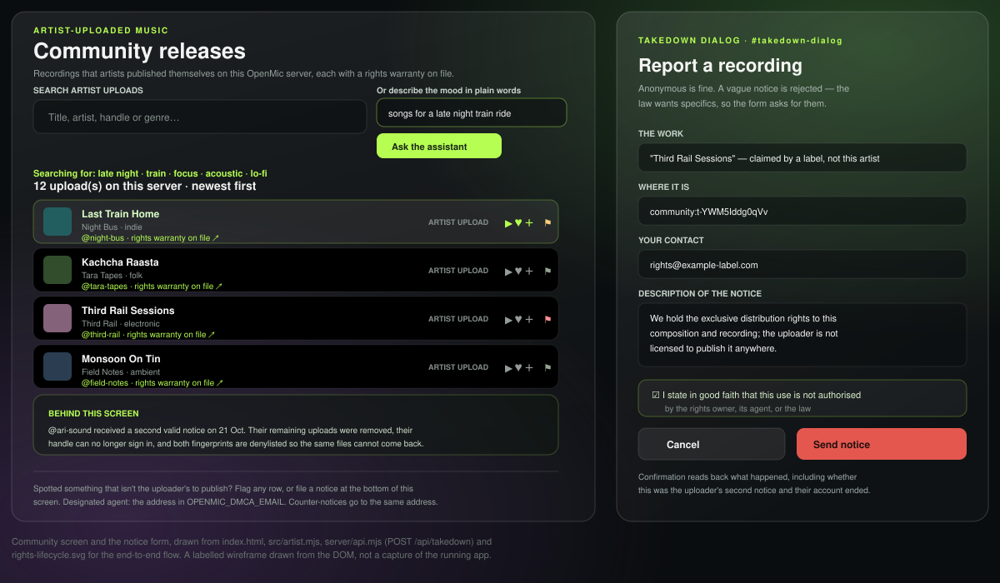
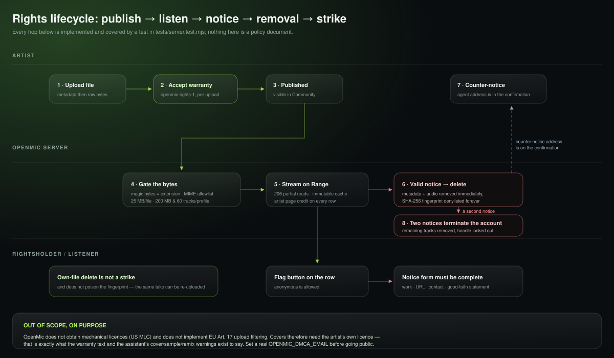
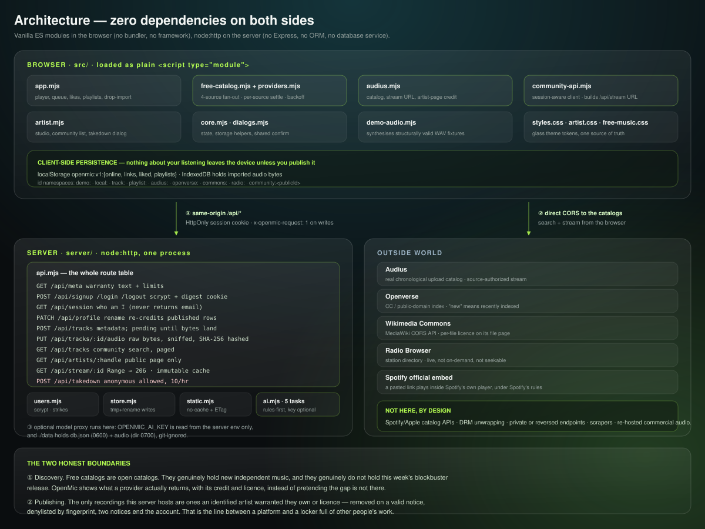

# OpenMic - open-source, no-subscription music player **and** artist publishing

A responsive, local-first, **MIT-licensed** music app that does two jobs:

1. **For listeners** — search four free-to-access music catalogs, play internet radio, import your own audio files, keep likes and playlists, all with no account, no checkout, no premium tier.
2. **For independent artists** — open a profile, upload recordings you actually own, and have them streamed from *your own* server to everyone on the **Community** screen. YouTube's publishing model, Spotify's listening model, one dependency-free codebase.



**What this is not.** It is not a Spotify catalog unlock. Third-party catalogs do not guarantee every new Bollywood, Punjabi, Hindi or international commercial song, and never will — those recordings are licensed to services that pay for them. Each track or station stays subject to its original provider's copyright, licence, terms, browser format support and availability. No scraping, no DRM bypass, no private or reversed API, no re-hosted commercial audio anywhere in this project. See [RESEARCH.md](./RESEARCH.md) for the clean-room notes on which *behaviours* were recreated and where the boundary sits.

---

## Use cases

Six things a real person can do end to end today. Each was click-through verified in a browser, and the parts a headless test can reach are covered by the suite.

| # | Who | Wants | Path in the app | Works today |
| --- | --- | --- | --- | --- |
| 1 | Listener, no account | Discover music without paying | **Free Music** → pick source → *New releases* / *Popular & radio* / search → play, like, add to playlist | Yes |
| 2 | Independent artist | Publish my own songs | **For artists** → sign up → profile → upload file → accept rights warranty → publish | Yes |
| 3 | Fan / A&R | Find artists by mood, not just by name | **Community** → describe a mood → *Ask the assistant* → search rewritten into catalog terms | Yes |
| 4 | Crate digester / DJ | My files, radio and open catalogs in one library | Drag audio anywhere, or *Add audio files* → likes, playlists, queue, shuffle/repeat | Yes |
| 5 | Rightsholder | Get an infringing upload removed | Flag the row (or the Community disclaimer) → complete the notice → file deleted, fingerprint denylisted, strike recorded | Yes |
| 6 | Operator | Run this on my own box | `npm start` with `PORT` / `OPENMIC_HOST` / `OPENMIC_DMCA_EMAIL` → nothing else to provision | Yes |

### 1 · A listener discovers music without a subscription

Open **Free Music**, choose *All 4 sources* or one provider, and search. The four APIs are queried in parallel and **each source renders as it settles**, so a slow or rate-limited provider never blanks the page — its state shows in the status line instead. Every row carries its provider, a credit link, and the licence or attribution the provider reported. Radio rows are marked **LIVE** and disable seeking, because a live broadcast has no position to seek to.



### 2 · An artist publishes their own recording

Press **For artists**, create an email + password account and a public handle, then fill in the profile card. In *Publish a recording*: choose the file, add title, genre and tags, tick the rights warranty, publish. Nothing becomes public until the audio bytes have landed — a metadata-only row cannot be streamed. The track then appears in **Community** and on `/api/artists/<handle>`, credited to the artist, and renaming the profile re-credits the artist's published rows.

The gates the server applies, whether or not the browser bothers to:

- **Two-step upload** — `POST /api/tracks` for metadata, then `PUT /api/tracks/:id/audio` for raw bytes.
- **Content is checked, not trusted** — extension and magic bytes must agree, MIME must be on the allowlist (mp3, m4a, aac, wav, ogg, opus, flac, webm), 25 MB per file, 200 MB and 60 tracks per profile, duplicate metadata+audio replays rejected.
- **A per-upload warranty** (`openmic-rights-1`, served by `/api/meta`, so changing the wording invalidates previously accepted text): the artist states they own or licence the recording and that it contains no ripped, sampled or re-uploaded material they are not cleared to distribute.
- **Playback by HTTP `Range`** — 206 partial bodies and 416 on bad ranges, so seeking a long file only moves the bytes the player asks for. The stream URL is built in the browser from the track id, so a response body can never point the player at another host.



### 3 · A listener finds artists by mood, with AI

On **Community**, type *"songs for a late night train ride"* and press *Ask the assistant*. The request goes to `POST /api/assistant` with `task: search`, comes back as catalog terms, and the list re-queries with them. In the studio the same endpoint drafts release titles from filenames, proposes genre/mood tags, drafts a bio, and — most usefully — flags rights problems before an artist publishes: samples, covers, "type beat" instrumentals, label deals, remixes, and audio pulled from a streaming link.



Two modes, one interface:

- **Local rules (default).** `server/ai.mjs` answers all five tasks (`title`, `tags`, `bio`, `rights`, `search`) with no key, no network and no per-call cost. This is what runs on a fresh clone and in every test.
- **Optional model proxy.** Set `OPENMIC_AI_KEY`, `OPENMIC_AI_MODEL` and `OPENMIC_AI_BASE_URL`. The server forwards a fenced, task-scoped prompt and parses JSON back out. The key never reaches the browser, the model sees only one artist's own draft text, and if the upstream is slow or fails the local rules answer instead with `degraded: true`.

### 4 · Your own files, radio and open tracks in one library

Drop audio anywhere in the window, or use *Add audio files*. Imported files live in browser **IndexedDB** and never upload anywhere; likes, playlists, saved links and stream metadata live in **localStorage** under `openmic:v1:*`. Track ids are namespaced (`demo:`, `local:`, `track:`, `playlist:`, `audius:`, `openverse:`, `commons:`, `radio:`, `community:<id>`) so a local file, a radio station and an artist upload can coexist in one queue. Pasting a Spotify link keeps using Spotify's official embeddable player under Spotify's own rules — OpenMic never touches that audio.

### 5 · A rightsholder gets a recording taken down

Anyone — anonymously — can flag a Community row or use the disclaimer link. A vague notice is rejected; a valid one must state the work, its location, contact details and a good-faith statement. On acceptance the recording is deleted immediately (metadata *and* audio file), its **SHA-256 fingerprint is denylisted** so it cannot come back through another account, the confirmation prints the agent address a counter-notice goes to, and the notice counts as a strike. **Two notices terminate the account**: remaining tracks are removed, sessions are dropped and the handle can no longer sign in. An artist deleting *their own* upload is not a strike and does not poison the fingerprint, so the same take can be re-uploaded.



### 6 · An operator runs it

One process, no dependencies, no database service:

```bash
git clone https://github.com/humaniods/spotymusic.git
cd spotymusic
npm start          # node server/server.mjs → http://localhost:5173
```

Accounts, track metadata and audio are written to `./data/` (git-ignored, directory `0700`, `db.json` `0600`, serialized tmp+rename writes). The server binds `127.0.0.1` by default; set `OPENMIC_HOST=0.0.0.0` only behind a proxy you control. Set `OPENMIC_DMCA_EMAIL` to a real address before publishing anywhere public — it is printed on every takedown confirmation and on the community disclaimer.

---

## Music sources (four open catalogs + artist uploads)

| Provider | What is available | Mode | API / licence information |
| --- | --- | --- | --- |
| [Audius](https://docs.audius.co/api/) | Artist-uploaded tracks, newest and trending | On-demand, source-authorized stream | Public read API; not all uploads are freely streamable |
| [Openverse](https://api.openverse.org/v1/) | Indexed Creative Commons and public-domain audio | Direct stream if the original URL works | Anonymous rate-limited REST search; each result carries its own attribution |
| [Wikimedia Commons](https://www.mediawiki.org/wiki/API:Cross-site_requests) | Freely licensed / public-domain files | Direct streaming from Commons | MediaWiki CORS API; per-file licence on its file page |
| [Radio Browser](https://api.radio-browser.info/) | Public internet radio listings worldwide | **Live radio**, not seekable on-demand songs | Free/open station directory; each station's stream and rights are separate |
| **OpenMic artist uploads** | Recordings published through **For artists** | On-demand, from your own server at `/api/stream/<id>` | Gated by a per-file rights warranty; every row links to the uploading artist |

**The app's MIT licence covers app code, not externally hosted music.** Attribution and redistribution rules vary by provider, and not all of them permit downloading or reusing a track. Listening to a public broadcast does not give anyone permission to record or redistribute it.

## Architecture



## Limitations we filled

The catalog problem cannot be solved honestly by an app this size. Nearly everything else on this list could be, and was — these were real defects found while clicking through every screen and reading the code behind them. Each is fixed; where a headless test can reach the behaviour, it now has one, and the hashes point at the commit that closed it.

| Gap that existed | What it looked like | What it is now |
| --- | --- | --- |
| No publishing path at all | Artists could listen, never upload | Accounts, profiles, two-step uploads, Range streaming, public artist pages — `7483c52` |
| Free-API search returned almost nothing | Searching an artist or song name showed empty lists | Openverse rebuilt against `/v1/`, Commons audio-type and noise filtering, per-source settle — `bfab3f8` |
| One slow source blocked every source | Whole page waited on the worst API | Each provider renders independently; failures report per source |
| Rate limits failed silently | A 429 looked like "no results" | Retry with backoff, and a visible status line |
| Saved free tracks vanished from search | A bookmarked Audius track was unfindable later | Saved rows are revived and stay searchable; duration clocked correctly — `cf3d092` |
| Library pollution and a runaway queue | One play could enqueue hundreds of rows | Explicit saves, bounded queue, namespaced ids |
| No delete actions; duplicate uploads accepted | Junk rows you could not remove; same file twice | Row-level delete for local and own uploads, duplicate fingerprint/metadata rejected |
| Ghost rows after a takedown | A removed upload stayed in likes and playlists and threw on play | Play failure probes the stream; a 404/410 forgets the row everywhere — `d066139` |
| Audius attribution could be redirected | A crafted `permalink` could point the credit link off-audius.co | Permalink shape validated, saved pages pinned to `https://audius.co` |
| Renaming a profile left stale credits | Published rows kept crediting an abandoned name | `PATCH /api/profile` re-credits that artist's tracks |
| Assistant missed remixes | "A remix of a Bollywood song" raised no flag | Remix rule added alongside sample, cover, type-beat, label and streaming-link rules |
| Stale app after every deploy | `python3 -m http.server` sent no `Cache-Control`, so browsers kept running an old `app.mjs` | `no-cache` + ETag for app files, `immutable` for audio — `server/static.mjs` |
| Server errors shown twice-escaped | `&amp;quot;` in the UI | Single-escape path fixed — `7b96fde` |
| Account store world-readable | `db.json` with password hashes in a shared worktree | Directory `0700`, file `0600`, git-ignored, `data/` never committed |
| Most of one stylesheet was dead | One unterminated `.row-remove` rule made the browser nest the rest of `styles.css` inside it, so the row grid, `.danger`, `.playlist-options` and `.row-remove` never applied | Repaired while theming — `32c25f7` |

## Limitations we are not going to fill

Stated plainly, because the interesting part of this project is where it stops.

**Legal and catalog**
- **No commercial catalog.** No Bollywood/Punjabi/Hindi/Western blockbusters on release day. Open catalogs hold open music; that is the ceiling, and no amount of code changes it without breaking the law.
- **No DRM removal, no private or reversed APIs, no scraping, no re-hosting of streams.** Spotify playback means Spotify's official embed, full stop.
- **No composition licensing.** OpenMic does not obtain mechanical licences (US MLC) and does not implement EU Art. 17 upload filtering. Covers need the artist's own licence — which is exactly what the warranty and the assistant's cover/sample/remix warnings exist to say.
- **`OPENMIC_DMCA_EMAIL` ships as `dmca@openmic.invalid`.** A placeholder is not a designated agent. Fix it before going public.

**Technical**
- **Codec support is the browser's,** not ours: no server-side transcoding, so a valid-but-unplayable file stays unplayable.
- **Live radio cannot be seeked,** has no duration, and can drop at any time.
- **Search is substring matching** across title, artist, handle, genre and tags — not fuzzy, not semantic, no embeddings, no recommendations engine, no follow feed.
- **Single-node JSON store.** No scale-out, no replicas, no backup tooling, and rate-limit counters live in that one process. Fine for a personal or community instance; not built for traffic.
- **No password reset, no email verification, no OAuth, no 2FA** — deliberately, since all four need an email or identity provider, which would break the zero-dependency promise. Losing a password means making a new account.
- **No admin dashboard.** Takedowns are enforced by the API and the file store; whoever runs an instance reads the confirmations.
- **No message is pushed to the uploader.** Email delivery would need a provider, which breaks the zero-dependency promise, so an artist discovers a takedown when their row disappears and reads the counter-notice address on the filer's confirmation. Notices *are* recorded server-side with target, contact text, handle and agent address.
- **No lyrics, no collaborative playlist editing, no shareable playlist links, no playback analytics or scrobbling.** Public pages exist for artists (`/api/artists/<handle>`), not for playlists.
- **The assistant is rules-first.** Without a configured model it pattern-matches text; it is a good prompt to make someone notice a rights problem, not a legal opinion.

## Security model in one paragraph

Salted `scrypt` (N=16384) password hashes, never logged in clear text. Sessions are random tokens in an `HttpOnly`, `SameSite=Lax` cookie of which only the SHA-256 digest is stored, so a leaked data file cannot revive a login. Writes require the `x-openmic-request: 1` marker (CSRF). Per-IP limits: signup 10/hr, login 8 per 15 min, takedown 10/hr, assistant 60/min signed-in and 20/min anonymous. Static serving is path-jailed to the project root. Email is never returned by any route except `/api/session` to its own owner.

## Tests

```bash
npm test           # 60 tests, no network access
```

`node --test tests/*.test.mjs` over six files: `core` (state, storage, queue), `providers` (adapters, filtering, backoff), `audius` (catalog, stream URLs, attribution safety), `community` (browser client, id normalisation), `demo-audio` (WAV fixture validity), `server` (boots the real server on an ephemeral port with a temporary data dir and drives every route, including uploads, Range reads, takedowns, strikes and the assistant). CI runs `node --check` across every module plus this suite on each push.

## Configuration

| Variable | Default | Purpose |
| --- | --- | --- |
| `PORT` | `5173` | Listen port |
| `OPENMIC_HOST` | `127.0.0.1` | Bind address; `0.0.0.0` only behind your own proxy |
| `OPENMIC_DMCA_EMAIL` | `dmca@openmic.invalid` | Designated-agent contact shown on notices |
| `OPENMIC_DATA_DIR` | `./data` | Account store + uploaded audio (git-ignored) |
| `OPENMIC_AI_KEY` / `_MODEL` / `_BASE_URL` | unset | Optional model proxy for the assistant |

The static player also runs on any plain file server (`npm run static`): Free Music, local files and Spotify embeds keep working, and the artist screens report "No OpenMic server is answering".

## Privacy

Imported local songs stay in browser IndexedDB. Favorites, playlists, saved links and stream metadata stay in browser localStorage. Free-source streams are fetched from the upstream providers, who receive ordinary requests from you. Artist accounts, uploaded audio and login-failure counters live on the OpenMic server in `./data/`. Nothing goes to a third party unless you configure the optional assistant model, and even then only the artist's own draft text is forwarded. No tracking scripts, no payment collection, no ads.

## Code map

- `src/app.mjs` — player, queues, local files, favorites, playlists, play-failure handling
- `src/core.mjs` / `src/dialogs.mjs` — state and storage helpers, shared confirm dialog
- `src/free-catalog.mjs` / `src/providers.mjs` / `src/audius.mjs` — source selector, multi-source aggregation, adapters
- `src/community-api.mjs` / `src/artist.mjs` — artist client and screens, community catalog, takedown dialog
- `src/demo-audio.mjs` — synthesises structurally valid WAV fixtures
- `src/styles.css` / `src/artist.css` / `src/free-music.css` — glass theme tokens and per-screen layers
- `server/server.mjs` — `node:http` entry, static + API dispatch
- `server/api.mjs` — accounts, uploads, streaming, takedowns, assistant routes, limits
- `server/users.mjs` / `server/store.mjs` / `server/static.mjs` / `server/ai.mjs` — credentials, JSON store, cache-correct serving, assistant rules
- `tests/*.test.mjs` — deterministic fixtures; `tests/server.test.mjs` boots the real server
- `docs/assets/*.svg` — the diagrams on this page, drawn from the real DOM and route structure

OpenMic is independent of Spotify, Openverse, Audius, Wikimedia and Radio Browser and is not endorsed by them. Application source is MIT; media reached through the app carries its own copyright and licence.

## License

[MIT](./LICENSE) for original application source code. Music accessed through the app does not.
